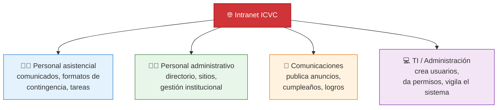

# 01 — ¿Qué es la Intranet del ICVC?

## En una frase

Es **la página interna del hospital**: el único lugar donde el colaborador encuentra comunicados, directorio, tareas, formatos y accesos a los sistemas.

## Analogía: el edificio digital

| Edificio real | Intranet |
|---|---|
| 🚪 Puerta de entrada | El portal web que abres en el navegador |
| 🧑‍💼 Recepcionista | El servidor que atiende y dirige a cada visitante |
| 🗂️ Oficinas y archivo | El cerebro que procesa solicitudes |
| 🏦 Bóveda | La base de datos donde se guarda todo |
| 🛡️ Vigilante | El control de usuarios y permisos |

## ¿A quién le sirve?

## ¿Qué problema resuelve?

Antes: información regada en chats, correos y papeles.
Ahora:

- Un solo punto de entrada.
- Comunicados oficiales con historial y aprobación.
- Directorio telefónico y de correos siempre actualizado.
- Tareas y logros con seguimiento.
- Accesos controlados por cargo (cada quien ve lo que le corresponde).
