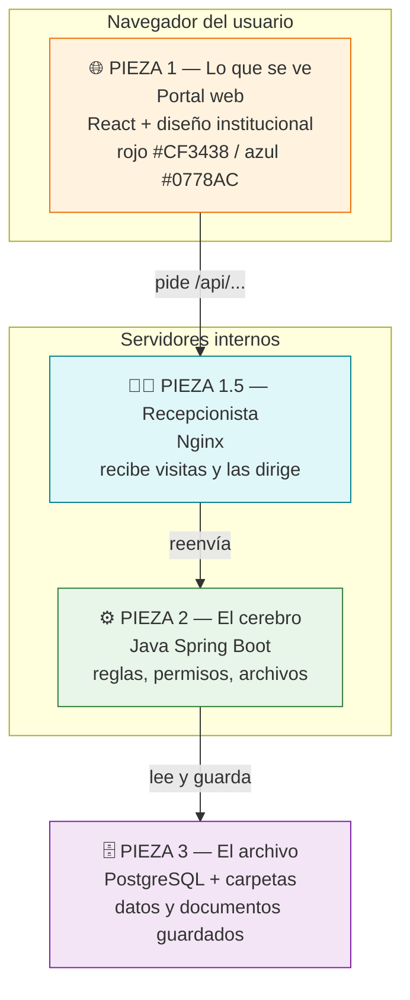
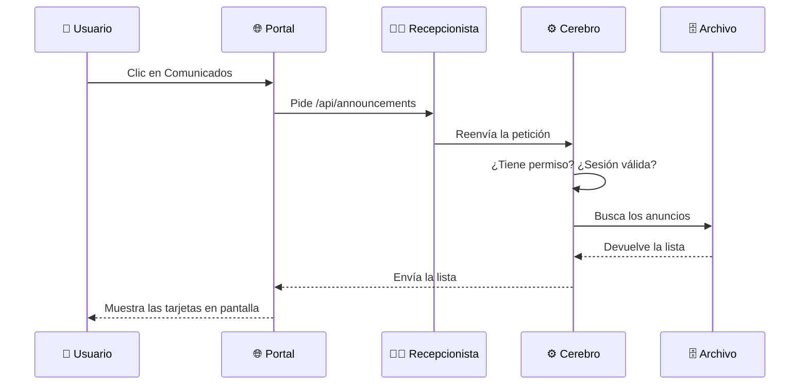

# 02 — ¿Cómo está construida? (las 3 piezas)

Todo el sistema tiene **3 piezas**. No necesitas saber programar para entenderlas.

## Pieza 1 — Lo que se ve (Portal)

- Página moderna que funciona en computador de oficina.
- 7 secciones (ver documento 03).
- Colores institucionales, menú superior + panel lateral de anuncios.
- Cuando falla internet o el cerebro está apagado, muestra los últimos datos guardados.

## Pieza 2 — El cerebro (Backend)

- Programa en Java que **decide**: ¿quién eres? ¿qué puedes ver? ¿dónde guardo esto?
- Organizado por temas: usuarios, comunicados, directorio, tareas, muro, formatos, enlaces.
- Guarda documentos (hasta 20 MB por archivo) en una carpeta `uploads`.
- Se vigila solo: expone su "estado de salud" para saber si está vivo.

## Pieza 3 — El archivo (Datos)

- Base de datos PostgreSQL **externa** (no se borra aunque se apaguen los servidores).
- Los cambios de estructura se aplican con versiones numeradas (Flyway V1→V28): como capítulos de un libro, en orden y sin saltos.
- Dos discos de respaldo lógico:
  - `uploads` → documentos y fotos.
  - `logs` → diario de lo que pasó.

## ¿Cómo viaja un clic? Ejemplo: "ver comunicados"

