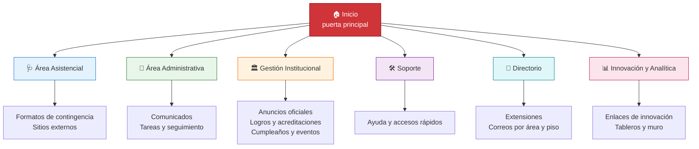
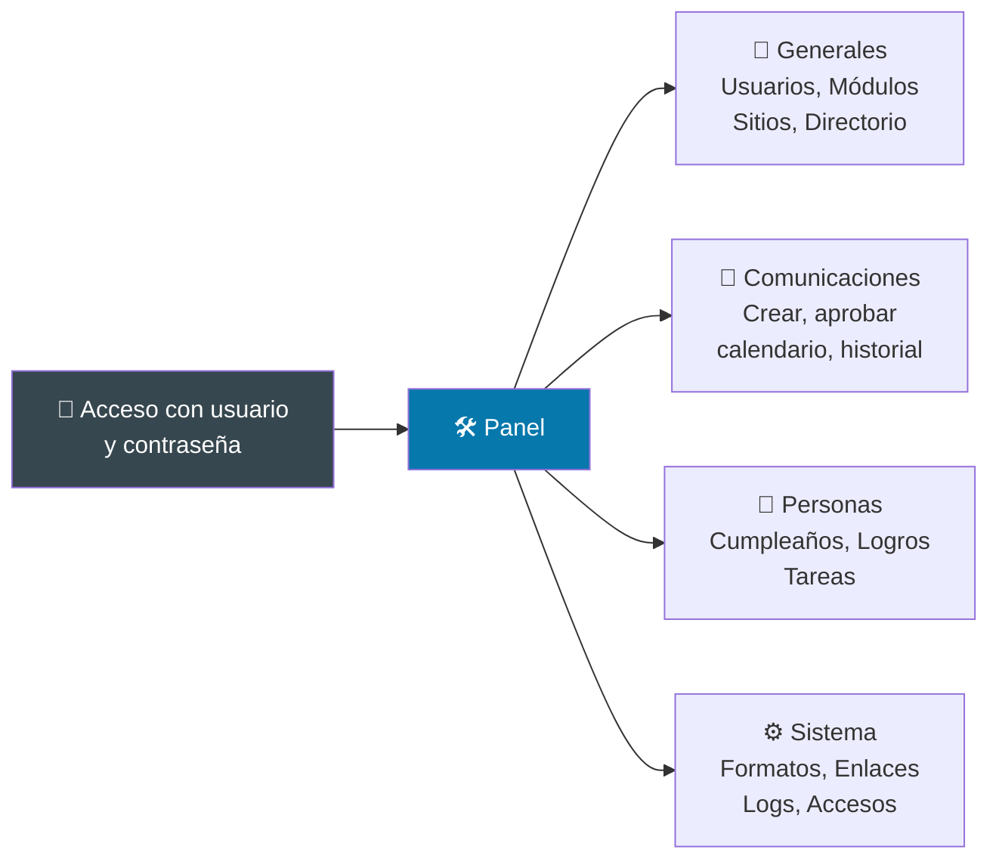
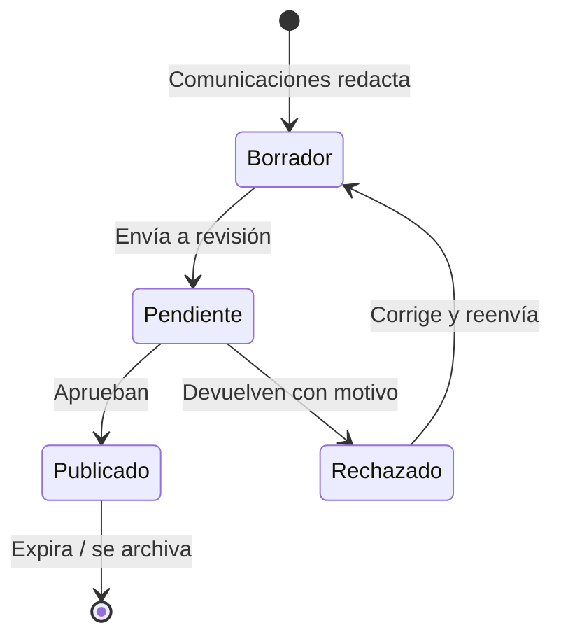

# 03 — ¿Qué puede hacer? (módulos)

## Mapa de las 7 secciones

| Sección | ¿Qué encuentra el usuario? | Ejemplo de uso |
|---|---|---|
| 🏠 Inicio | Resumen, anuncios destacados, cumpleaños | "¿Qué hay nuevo hoy?" |
| 🩺 Área Asistencial | Formatos de contingencia, sitios clínicos | "Se cayó el sistema, uso el formato papel" |
| 💼 Área Administrativa | Comunicados, tareas con seguimiento y comentarios | "Reviso mi tarea pendiente y subo evidencia" |
| 🏛️ Gestión Institucional | Anuncios oficiales, logros, calendario | "Publican el logro de acreditación" |
| 🛠️ Soporte | Ayuda, accesos rápidos, redirecciones | "Entro al sistema de historia clínica" |
| 📇 Directorio | Extensiones, correos, áreas, pisos | "Busco la extensión de farmacia" |
| 📊 Innovación y Analítica | Enlaces de innovación + muro de mensajes | "Dejo un mensaje en el muro" |

## El panel de administración (solo autorizados)

Es una ventana aparte con ~20 pantallas:

- **Generales:** crear usuarios, abrir/cerrar módulos, registrar sitios y extensiones.
- **Comunicaciones:** redactar anuncio → queda pendiente → se aprueba → se publica. Todo queda en historial.
- **Personas:** cumpleaños manuales, logros con fotos, tareas con responsables.
- **Sistema:** formatos de contingencia, enlaces, accesos rápidos y diario de auditoría (quién hizo qué).

## Ciclo de vida de un anuncio

