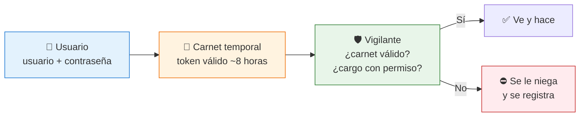
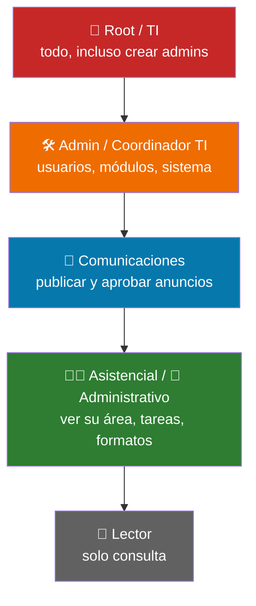

# 04 — Seguridad y roles (¿quién puede ver qué?)

## La idea: carnet + llave por cargo

- Al entrar, el sistema entrega un **carnet digital** que dura unas 8 horas. Al vencer, pide entrar de nuevo.
- Cada acción pregunta: **¿tu cargo tiene permiso para este módulo y esta acción?**
- Todo lo importante se anota en el **diario de auditoría**: quién entró, qué creó, qué aprobó.

## Niveles de acceso (de más a menos poder)

En el sistema existen 14 cargos/roles (root, admin, ti, coordinador_ti, sistemas, comunicaciones, asistencial, administrativo, etc.). Cada cargo tiene una tabla de **módulo × acción** (ver, crear, aprobar, borrar).

## ¿Qué puede hacer cada uno?

| Acción | Lector | Asistencial / Admin. | Comunicaciones | Admin TI / Root |
|---|---|---|---|---|
| Ver portal y directorio | ✅ | ✅ | ✅ | ✅ |
| Comentar / tareas propias | — | ✅ | ✅ | ✅ |
| Crear anuncios | — | — | ✅ | ✅ |
| Aprobar / publicar | — | — | ✅ | ✅ |
| Crear usuarios y dar permisos | — | — | — | ✅ |
| Ver diario de auditoría | — | — | — | ✅ |

## ¿Qué pasa si algo sale mal?

- Contraseña olvidada → se pide restablecimiento y TI lo aprueba.
- Carnet vencido o inválido → se cierra la sesión y se pide entrar de nuevo.
- Intento sin permiso → se niega y queda registrado.
