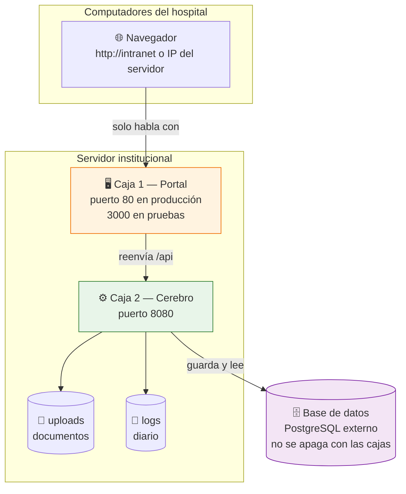
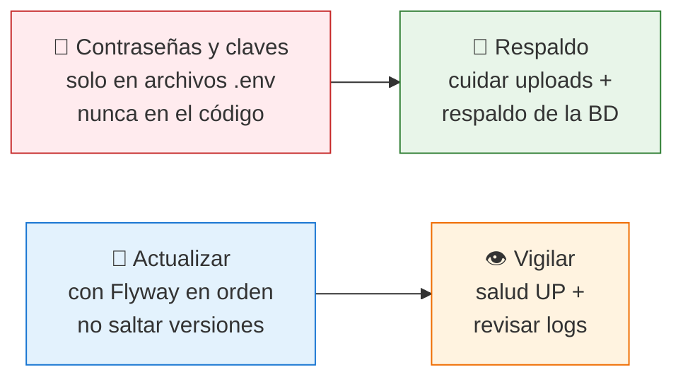

# 05 — ¿Dónde vive y cómo se enciende?

## Dónde está instalado

- Solo el **Portal** es visible para los usuarios. El cerebro y la base de datos están ocultos.
- Hay 2 ambientes:
  - **Pruebas:** portal en puerto `3000`, cerebro en `8080`, perfil `dev`.
  - **Producción:** portal en puerto `80`, cerebro en `8080`, perfil `prod`.

## Cómo encender y apagar (para TI)

| Ambiente | Comando (en la carpeta raíz del proyecto) | Para abrir |
|---|---|---|
| Pruebas | `docker compose --env-file intranet-backend/.env_pruebas up --build -d` | Portal `http://localhost:3000` · Cerebro `http://localhost:8080/swagger-ui.html` |
| Producción | `docker compose --env-file intranet-backend/.env up --build -d` | Portal `http://localhost` · Cerebro `http://localhost:8080` |
| Apagar | `docker compose down` | — |
| Ver salud | Revisar `.../actuator/health` del cerebro | Debe decir `UP` |

Atajos: `scripts/run-dev.ps1` (pruebas) y `scripts/run-prod.ps1` (producción) hacen lo mismo.

## Reglas de seguridad de la casa

1. Las claves viven en `.env` / `.env_pruebas` (no se suben a Git).
2. El portal **no arranca** hasta que el cerebro está sano (espera automática).
3. Si algo se daña, ambas cajas se reinician solas; los documentos y logs sobreviven porque están en volúmenes aparte.

## ¿A quién llamar?

| Problema | A quién avisar | Dato útil para decirle |
|---|---|---|
| No abre el portal | TI | Foto del error + hora + equipo |
| No puedo entrar (usuario) | TI / Administración | Nombre de usuario y mensaje exacto |
| Un anuncio no se publica | Comunicaciones | Título del anuncio y fecha |
| Falta una extensión del directorio | Administración | Área, piso y número correcto |
