# 🏥 Intranet Corporativa ICVC — Arquitectura y Topología

> **Instituto Cardiovascular del Cesar (ICVC)**
> Documento explicativo del funcionamiento del sistema, pensado para público **técnico y no técnico**.

---

## 📌 ¿Qué es esta Intranet y para qué sirve?

La Intranet Corporativa es el **portal web interno** del ICVC. Es la puerta de entrada digital para todos los colaboradores: desde allí acceden a las aplicaciones del hospital, consultan el directorio telefónico, leen comunicados, revisan sus tareas y gestionan información institucional.

**Analogía simple:** imagina un **edificio corporativo digital**.

| Edificio físico | Equivalente en la Intranet |
|---|---|
| 🚪 Puerta de entrada | El portal web (lo que ves en el navegador) |
| 🧑💼 Recepcionista | El **servidor web** (Nginx) que atiende a los visitantes |
| 🗂️ Archivo y oficinas | El **servidor de aplicaciones** (Backend) que procesa la información |
| 🏦 Bóveda de documentos | La **base de datos** (PostgreSQL) donde vive la información |
| 🛡️ Guardia de seguridad | El sistema de **autenticación y permisos** (JWT + Roles) |

---

## 🧭 Vista General del Sistema (Nivel gerencial)

El sistema está compuesto por **dos grandes piezas** que trabajan juntas:

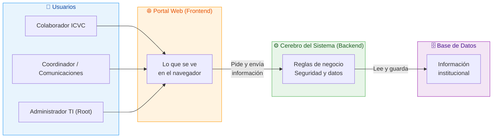

> 💡 **En palabras simples:** el usuario abre el navegador y ve el portal. Cuando hace clic (por ejemplo, "ver comunicados"), el navegador le pide los datos al cerebro del sistema, y este a su vez los busca y los guarda en la base de datos.

---

## 🏗️ Arquitectura de Alto Nivel (Modelo de 3 capas)

El sistema sigue un patrón clásico y robusto llamado **arquitectura de tres capas**. Cada capa tiene una responsabilidad clara y no invade la de las demás.

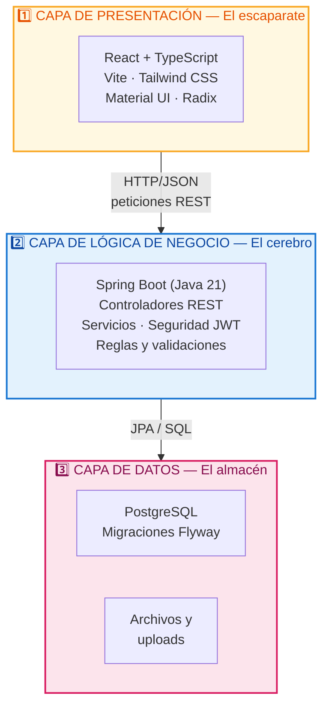

| Capa | Nombre | Responsabilidad | Si falla… |
|---|---|---|---|
| 1️⃣ | **Presentación** | Mostrar la interfaz y capturar acciones del usuario | El usuario ve una página en blanco |
| 2️⃣ | **Negocio** | Validar, decidir, aplicar reglas y seguridad | Nada se puede guardar ni consultar |
| 3️⃣ | **Datos** | Guardar y recuperar información permanente | Se pierde el acceso a la información |

---

## 🗺️ Topología de Despliegue (Cómo está montado el sistema)

Todo el sistema corre dentro de **contenedores Docker** que viven en una red privada interna. Nada queda directamente expuesto salvo el portal.

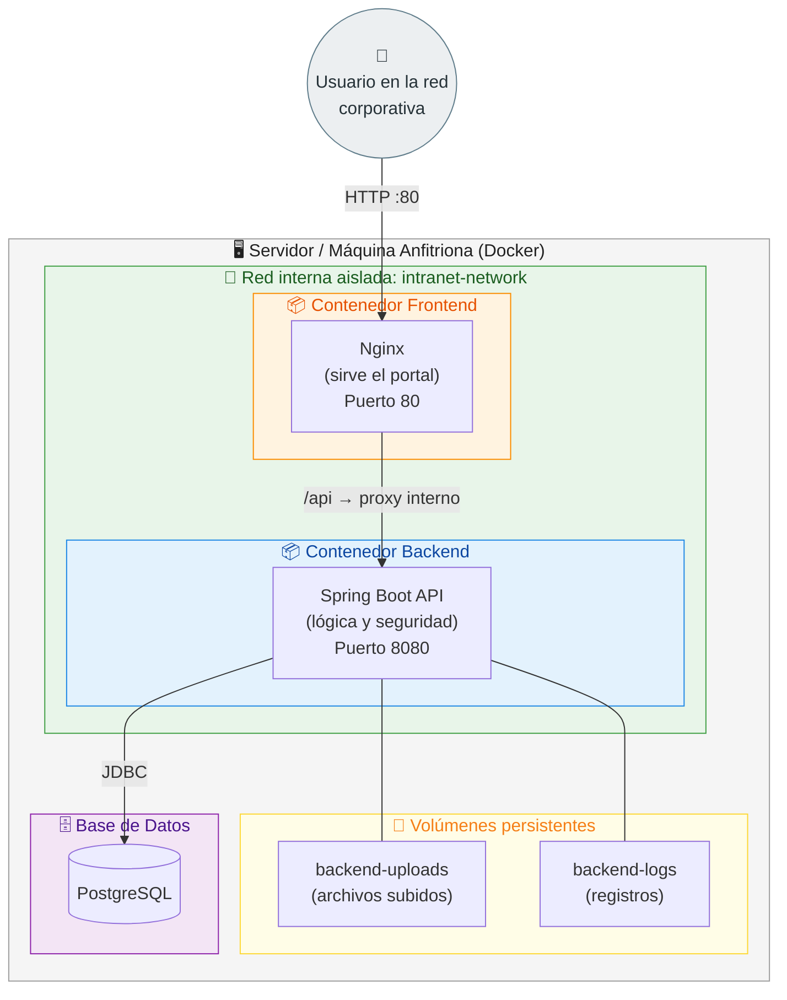

### 🔒 Detalles de la topología

- **Solo el Frontend (puerto 80) está abierto** al usuario. El Backend (8080) queda detrás del proxy interno.
- El Backend **no se comunica directamente** con el navegador: Nginx reenvía las peticiones que empiezan con `/api`.
- Ambos contenedores se comunican por **nombre de servicio** (`backend`, `frontend`) dentro de la red `intranet-network`, sin necesidad de IPs fijas.
- Los **uploads** y **logs** se guardan en volúmenes, así no se pierden al reiniciar el contenedor.

---

## 🔄 Flujo de una Petición (Ciclo de vida paso a paso)

Este es el recorrido que hace cualquier acción del usuario, por ejemplo **"ver los comunicados"**.

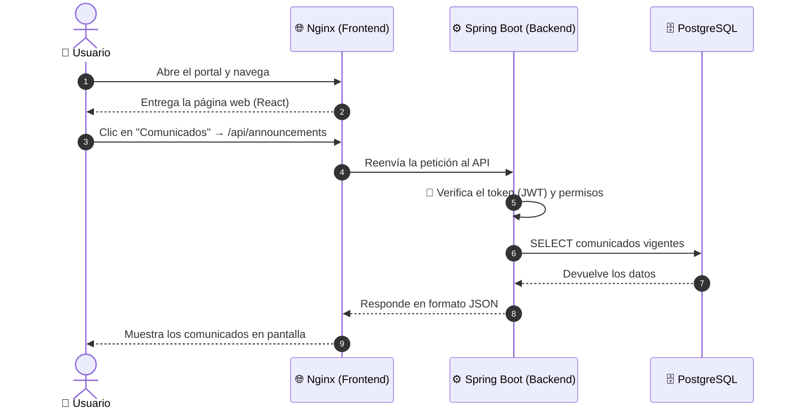

> ⏱️ Todo este recorrido ocurre en **milisegundos** y de forma transparente para el usuario.

---

## 🧩 Descomposición de Componentes

### 🎨 Frontend — "El Portal" (`Corporate-Intranet-Portal/`)

La parte que el usuario **ve y toca**. Construida como una *Single Page Application* (SPA) moderna.

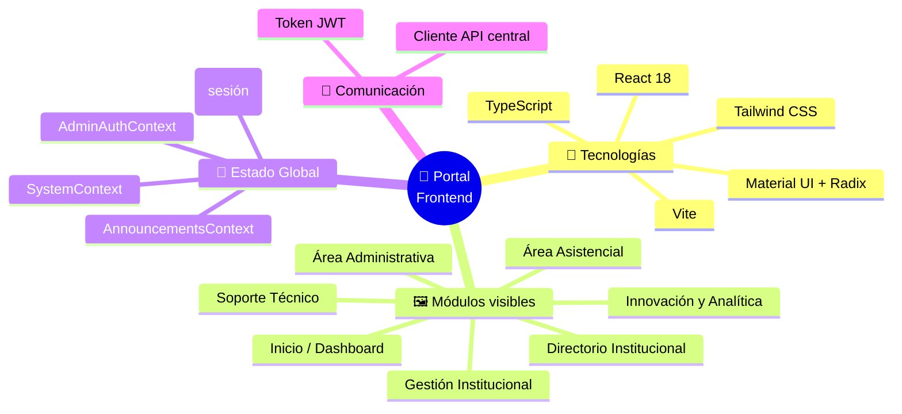

### ⚙️ Backend — "El Cerebro" (`intranet-backend/`)

La parte que **procesa, valida, protege y almacena**. Organizado por dominios funcionales.

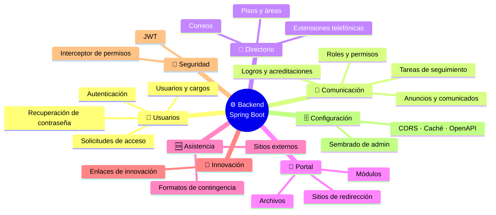

### 🗄️ Base de Datos — "La Bóveda" (`PostgreSQL`)

La información se guarda de forma **estructurada y versionada**. Los cambios al esquema se aplican con **migraciones Flyway** (V1 → V24), lo que garantiza que la estructura evolucione de forma controlada y auditable.

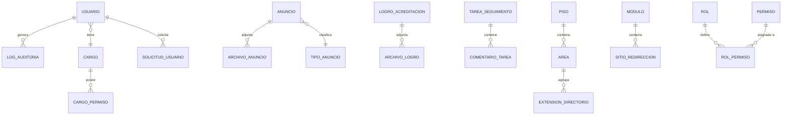

---

## 👥 Modelo de Acceso y Seguridad (RBAC)

El sistema usa **Control de Acceso Basado en Roles (RBAC)**. Dicho de forma sencilla: *cada persona ve y hace únicamente lo que su rol le permite*.

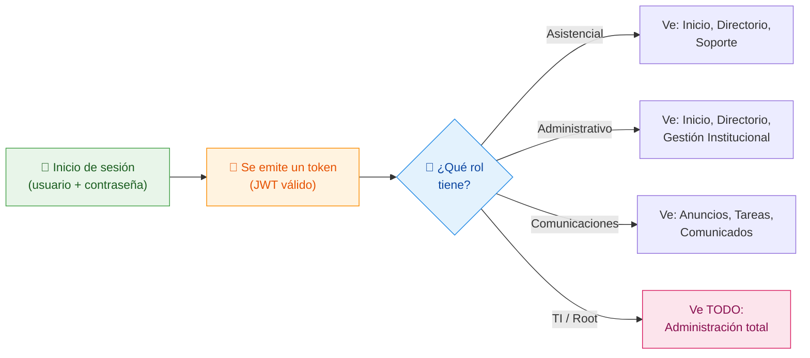

**Medidas de seguridad incluidas:**

| Medida | Descripción |
|---|---|
| 🔐 **JWT** | Cada sesión viaja con un "pase" firmado y con caducidad. |
| 👮 **Interceptor de permisos** | El backend valida cada acción contra los permisos del rol/cargo. |
| 🧾 **Auditoría (Logs)** | Se registra quién hizo qué y cuándo. |
| 🔄 **Sesión volátil** | La sesión se cierra al refrescar la página (requisito de seguridad). |
| 🛡️ **Cabeceras de seguridad** | Nginx agrega protección contra ataques comunes (XSS, clickjacking). |

---

## 🧰 Stack Tecnológico Completo

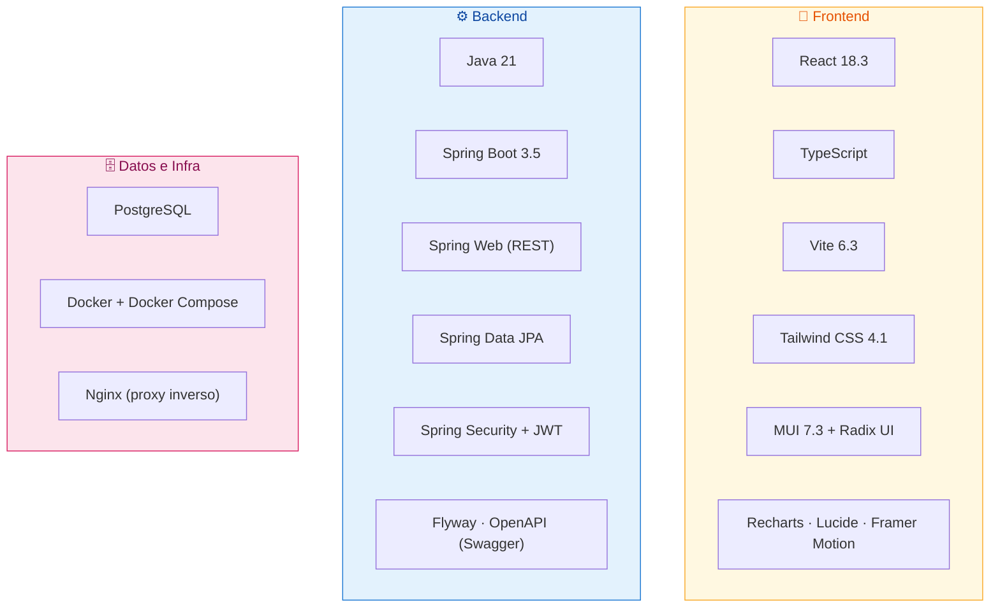

| Componente | Tecnología | Para qué sirve |
|---|---|---|
| Interfaz visual | React + Tailwind + MUI | Construir la experiencia de usuario |
| Cerebro | Spring Boot (Java 21) | Procesar la lógica y las reglas |
| Seguridad | Spring Security + JWT | Autenticar y autorizar |
| Base de datos | PostgreSQL | Guardar la información |
| Versionado de BD | Flyway | Evolucionar la base sin perder datos |
| Documentación API | OpenAPI / Swagger | Documentar los servicios automáticamente |
| Monitoreo | Spring Actuator | Verificar que el sistema esté "saludable" (`/actuator/health`) |
| Contenedores | Docker / Compose | Empaquetar y desplegar el sistema |
| Puerta de entrada | Nginx | Servir el portal y enrutar al backend |

---

## 🌍 Ambientes de Despliegue

Existen **tres configuraciones** para distintos propósitos. Todas usan la misma arquitectura, solo cambian puertos y parámetros.

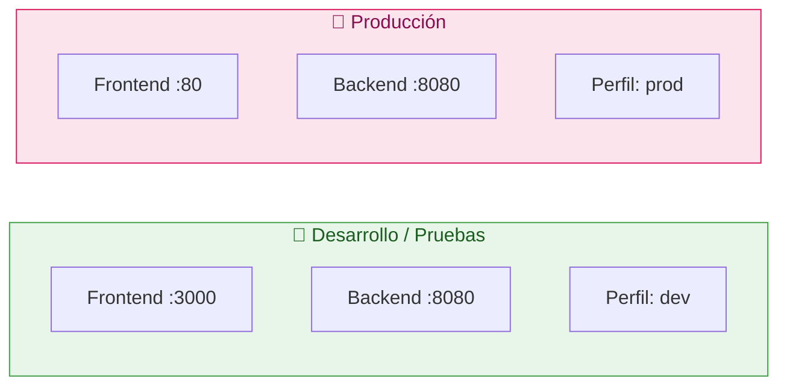

| Ambiente | Archivo | Puerto Frontend | Puerto Backend | Perfil Spring |
|---|---|---|---|---|
| 🧪 Desarrollo | `docker-compose.dev.yml` | `3000` | `8080` | `dev` |
| ✅ Producción | `docker-compose.prod.yml` | `80` | `8080` | `prod` |
| 🔀 Unificado | `docker-compose.yml` | variable | variable | variable |

**Comandos de arranque:**

```bash
# Desarrollo / pruebas
docker compose --env-file intranet-backend/.env_pruebas up --build

# Producción
docker compose --env-file intranet-backend/.env up --build
```

---

## 🧠 Módulos Funcionales (Qué puede hacer el usuario)

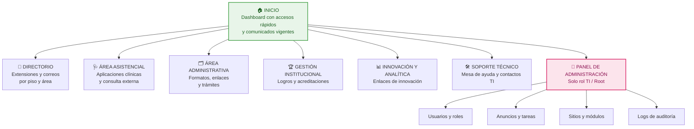

---

## 🆘 Alta Disponibilidad y Resiliencia

El sistema incorpora mecanismos para "cuidarse a sí mismo":

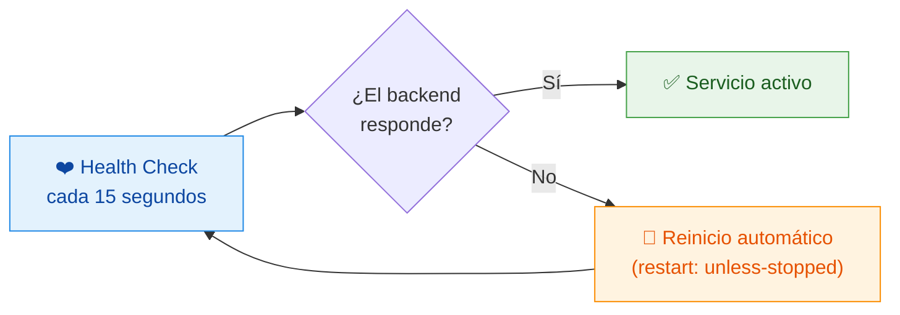

- **Dependencias ordenadas:** el Frontend no arranca hasta que el Backend esté *saludable*.
- **Reinicio automático:** si un contenedor falla, Docker lo levanta de nuevo.
- **Volúmenes persistentes:** archivos y logs sobreviven a los reinicios.

---

## 📚 Glosario para No Técnicos

| Término | Significado sencillo |
|---|---|
| **Frontend** | Lo que ves y usas en el navegador |
| **Backend** | El motor invisible que procesa todo |
| **Base de datos** | El archivador donde se guarda la información |
| **API** | El "mensajero" que comunica el portal con el motor |
| **Contenedor** | Una "caja" aislada donde corre una parte del sistema |
| **Docker** | La herramienta que crea y administra esas cajas |
| **Nginx** | El portero que recibe a los usuarios y los dirige |
| **JWT** | Un pase digital firmado que demuestra quién eres |
| **RBAC** | Regla que da permisos según el rol de cada persona |
| **SPA** | Página que funciona sin recargar en cada clic |
| **Migración** | Cambio controlado a la estructura de la base de datos |
| **Health Check** | Chequeo automático de que el sistema está vivo |

---

## 🗂️ Mapa del Repositorio

```text
Corporate-Intranet-Portal/
│
├── 🎨 Corporate-Intranet-Portal/     ← El Portal (Frontend)
│   ├── src/app/components/            ← Componentes y módulos visuales
│   ├── src/app/api/                   ← Comunicación con el Backend
│   ├── src/app/contexts/              ← Estado global (sesión, anuncios)
│   ├── nginx.conf                     ← Configuración del portero
│   └── Dockerfile                     ← Receta del contenedor Frontend
│
├── ⚙️ intranet-backend/               ← El Cerebro (Backend)
│   ├── src/main/java/.../             ← Código por dominios funcionales
│   │   ├── user/ · communication/     ← Usuarios y comunicaciones
│   │   ├── directory/ · portal/       ← Directorio y portal
│   │   ├── assistance/ · innovation/  ← Asistencia e innovación
│   │   ├── permisos/ · security/      ← Seguridad y permisos
│   │   └── config/ · common/          ← Configuración y utilidades
│   ├── src/main/resources/db/migration/ ← Migraciones de la base de datos
│   └── Dockerfile                     ← Receta del contenedor Backend
│
├── 🐳 docker-compose.yml              ← Orquestación unificada
├── 🐳 docker-compose.dev.yml          ← Configuración de desarrollo
├── 🐳 docker-compose.prod.yml         ← Configuración de producción
└── 📄 docs/                           ← Documentación (este archivo)
```

---

## ✅ Resumen Ejecutivo (Una sola mirada)

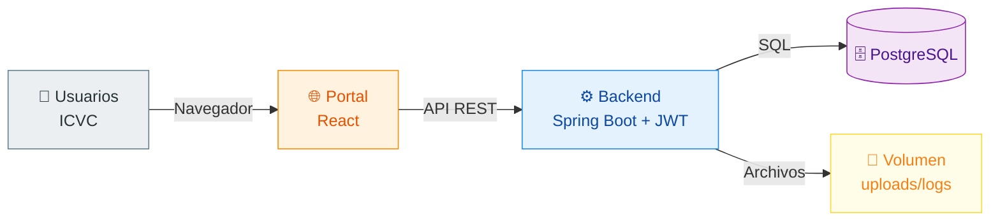

**La Intranet ICVC es un portal web moderno, seguro y centralizado** que unifica la comunicación interna, el directorio, los accesos a aplicaciones y la administración de usuarios, todo dentro de una arquitectura en capas empaquetada con Docker, con una puerta de entrada única (Nginx) y un modelo de permisos por roles.

---

*Documento generado para el Instituto Cardiovascular del Cesar (ICVC).*
*Los diagramas utilizan Mermaid y se visualizan correctamente en GitHub, GitLab y editores compatibles.*
